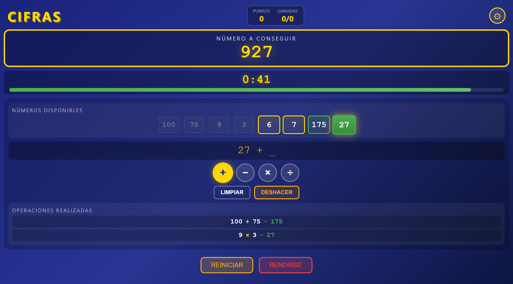

# Cifras · Numbers Game

A browser version of the **numbers round** from the Spanish TV quiz show *Cifras y Letras*, built with **Angular 21** using Signals, standalone components and zoneless change detection.

Combine six numbers with basic arithmetic to reach a random three-digit target before the clock runs out. Then compare your answer with the best solution, which a built-in backtracking solver finds for you.

**▶ Live demo:** https://pcolina.github.io/cifras/



> The game UI is in Spanish, like the original TV show.

---

## How to play

1. Choose how many **big numbers** (25, 50, 75, 100) to draw, from 0 to 4. The rest are small numbers from 1 to 10, for **6 numbers** in total.
2. A random **target between 100 and 999** appears and the timer starts. The default is 45 seconds, as on TV.
3. Pick a number, an operator (`+ − × ÷`) and a second number. The result becomes a new number you can use in later steps.
4. Get as close to the target as you can. **Undo** your last step or **restart** with the same numbers at any time.
5. When time runs out, or you give up, the solver shows the **best possible solution**.

**Rules:** every result must be a **positive integer**. Subtractions can't go to zero or below, and divisions must be exact. Each number can be used only once.

**Scoring:** exact = 10 points · within 5 = 7 points · within 10 = 5 points. The game keeps your total score, games played and games won.

## Features

- Game settings: time limit of 30 s, 45 s, 60 s, 90 s or 120 s, or **no limit** (the timer counts up), plus the number of big numbers.
- Step-by-step calculator with checks against the game rules and clear error messages.
- Undo, restart with the same numbers, and start a new round.
- **Automatic solver** using recursive backtracking over every pair of numbers and every operation. It stops as soon as it finds an exact solution, prefers shorter solutions when two results are equally close, and gives up after 100,000 search steps so the browser never freezes.
- Score and statistics across rounds.

## Tech stack

| Area | Choice |
|---|---|
| Framework | Angular 21: standalone components, `@if`/`@for` control flow, `inject()`, `output()` |
| State | Angular **Signals** (`signal`, `computed`, read-only public state) in a single `GameService` |
| Change detection | **Zoneless** (no `zone.js`) |
| Async / timer | RxJS `interval` and `takeUntil`, exposed to the UI as signals |
| Styling | SCSS, one stylesheet per component |
| Testing | Vitest (Angular CLI's default runner) |
| Tooling | Angular CLI, Prettier, Angular CLI MCP server for AI-assisted development |

## Architecture

```
src/app/
├── models/          # GameState, GameSettings, Operation, Solution
├── services/
│   ├── game.service.ts     # Game state (Signals): rounds, operations, undo, scoring
│   ├── solver.service.ts   # Backtracking solver with a search limit
│   └── timer.service.ts    # Countdown / count-up timer (RxJS → Signals)
└── components/
    ├── game-board/         # Main layout and game flow
    ├── number-selector/    # Number cards
    ├── calculator/         # Operation builder and rule checks
    ├── timer/              # Timer and progress bar
    ├── solution-display/   # Your answer vs. best solution
    └── settings/           # Time and big-number settings
```

State lives in services as **private writable signals** and is exposed as **read-only signals**. Components use `computed()` for derived values, such as the numbers still available or the current expression, so data only flows one way.

## Getting started

Requires **Node.js 20+**.

```bash
git clone https://github.com/pcolina/cifras.git
cd cifras
npm install
npm start          # http://localhost:4200
```

| Command | Description |
|---|---|
| `npm start` | Dev server with live reload |
| `npm run build` | Production build in `dist/` |
| `npm test` | Unit tests with Vitest |

## Built with AI assistance

Built with **Claude Code** and the **Angular CLI MCP server** as pair-programming tools. The architecture, game rules and code review are my own.

## Author

**Pablo Colina** · Senior Frontend Engineer (Angular)
[LinkedIn](https://www.linkedin.com/in/pcolinadev) · [GitHub](https://github.com/pcolina)
